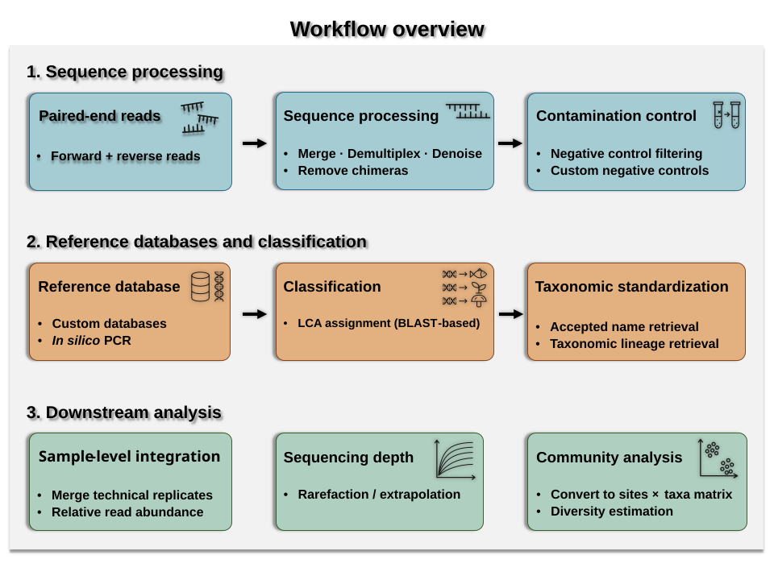

# METAeDNA

METAeDNA is an R package for environmental DNA (eDNA) metabarcoding analysis,
from paired-end sequencing reads to taxon abundance matrices and diversity
estimates. It provides tools for read merging, primer and tag assignment,
denoising, blank correction, reference database construction, and taxonomic
classification.

PCR reactions are identified by primer and nucleotide-tag combinations,
including technical replicates and blanks. The example library uses paired
8-bp tags before amplicons are pooled for library preparation
(Taberlet et al., 2018); other tag lengths can be specified in the reaction table.

## Workflow overview



## Step-by-step tutorials

Start with the [workflow overview](vignettes/00_Workflow_overview.Rmd),
then follow the three tutorials in order:

| Tutorial | Contents |
|---|---|
| [1. Sequence processing](vignettes/01_Sequence_processing.Rmd) | Merge paired reads, assign PCR reactions, collapse sequences, denoise, remove chimeras, and correct blank counts. |
| [2. Reference databases and taxonomy](vignettes/02_Reference_taxonomy.Rmd) | Build NCBI and COL taxonomy databases, obtain reference sequences, run in-silico PCR, and assign taxonomy. |
| [3. Sequencing depth and diversity](vignettes/03_Community_analysis.Rmd) | Select classified sequences, calculate RRA, merge technical replicates, build community matrices, and analyse sequencing depth and diversity. |

Detailed commands, parameters, example data, and input formats are maintained
in these tutorials. Run them from the same working directory; saved RDS files
connect the steps. Part 1 retains reaction-level counts, and Part 3 calculates
RRA after selecting classified sequences.

## Installation

Install from GitHub:

```r
# install.packages("remotes") # Run once if needed.
remotes::install_github("intactcircle/METAeDNA", upgrade = "never")
library(METAeDNA)
```

Alternatively, install a downloaded source archive:

```r
remotes::install_local("METAeDNA_1.0.0.tar.gz", upgrade = "never")
```

## System requirements

- R >= 4.0.0
- C++17 compiler
- zlib
- Optional external tools:
  - [NCBI BLAST+](https://ftp.ncbi.nlm.nih.gov/blast/executables/blast+/LATEST/) for reference extraction, database construction, and similarity searches.
  - [VSEARCH](https://github.com/torognes/vsearch/releases) for chimera removal and sequence clustering.

Download the external tools for the operating system and extract them locally.
Executable-path setup is described in the
[workflow overview](vignettes/00_Workflow_overview.Rmd#configure-external-software).
Large reference databases and NCBI downloads require sufficient storage space.

## Reference

Taberlet P, Bonin A, Zinger L, Coissac E. (2018). *Environmental DNA: For
Biodiversity Research and Monitoring*. Oxford University Press, Chapter 6,
"DNA amplification and multiplexing".
[DOI](https://doi.org/10.1093/oso/9780198767220.001.0001).

## License

[MIT](LICENSE.md).

