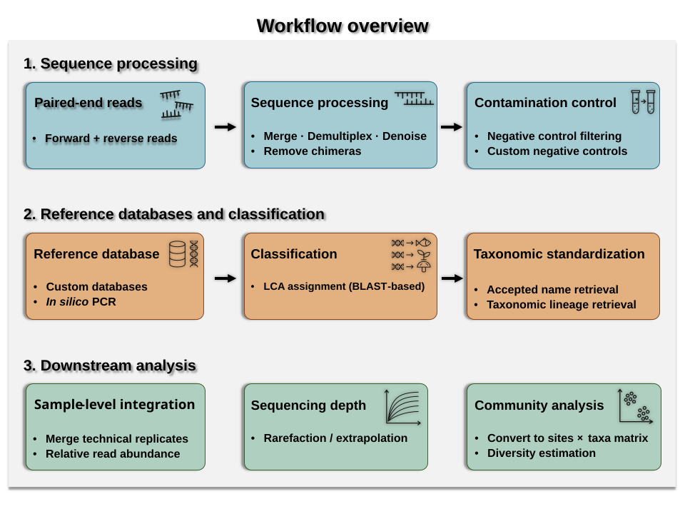

Workflow overview
================

The workflow is divided into three tutorials. Run them from the same
working directory; intermediate RDS files connect the steps.

| Tutorial | Main inputs | Saved outputs |
|----|----|----|
| [1. Sequence processing](01_Sequence_processing.md) | Paired FASTQ, reaction definitions, blank and replicate design | `data/workflow_tables.rds`: cleaned reaction counts and control table |
| [2. Reference databases and taxonomy](02_Reference_taxonomy.md) | Species checklist, local nt or downloaded reference records, cleaned sequences | `data/taxonomy_results.rds`: classifications linked by `SEQ` |
| [3. Sequencing depth and diversity](03_Community_analysis.md) | Reaction counts, control table, classification results | Sample RRA, community matrix, depth summaries, diversity and plots |

Part 1 ends at corrected reaction counts. Part 2 builds references and
assigns taxonomy. Part 3 selects classified sequences through `SEQ`,
calculates RRA within each reaction, and merges technical replicates.
Each reaction’s RRA denominator is its total retained classified reads.
Sequencing-depth summaries use reaction counts, not RRA. Part 2 also
accepts independent BLAST tables.

<figure>

<figcaption aria-hidden="true">METAeDNA workflow</figcaption>
</figure>

# About METAeDNA

METAeDNA processes environmental DNA metabarcoding reads, assigns
taxonomy, and calculates taxon abundances and diversity.

Reaction labels are nucleotide tags used for tag-based multiplexing
during library preparation, not target-gene markers. The example uses
paired 8-bp tags to distinguish PCR reactions before pooling. Primer and
tag combinations retain the link to samples, technical replicates, and
blanks. Other tag lengths can be specified in the reaction table.

> **Installation**
>
> METAeDNA requires R 4.0 or later, a C++ compiler, and zlib. OpenMP is
> used for multithreading when supported by the compiler. Install the R
> package from the supplied source archive:

``` r
# install.packages("remotes") # Run once if needed.
remotes::install_local("METAeDNA_1.0.0.tar.gz", upgrade = "never")

library(METAeDNA)
packageVersion("METAeDNA")
```

## Configure external software

Software releases are available for each operating system:

- [VSEARCH releases](https://github.com/torognes/vsearch/releases):
  chimera removal and sequence clustering.
- [NCBI BLAST+
  downloads](https://ftp.ncbi.nlm.nih.gov/blast/executables/blast+/LATEST/):
  reference database construction and similarity searches.

Extract or install the software first. Give the folders containing the
executables: `vsearch` for VSEARCH, and `blastn`, `blastdbcmd`, and
`makeblastdb` for BLAST+. On Windows these files end in `.exe`. For
BLAST+, this is normally its `bin` folder.

The paths below identify the executable folders. A single path is
sufficient when both programs share a folder.

``` r
tool_dirs <- c("software/blast/bin", "software/vsearch/bin")
# A shared executable folder instead:
# tool_dirs <- "software/bin"

Sys.setenv(PATH = paste(c(tool_dirs, Sys.getenv("PATH")), collapse = .Platform$path.sep))
Sys.which(c("vsearch", "blastn", "blastdbcmd", "makeblastdb"))
```

This sets the search path for the current R session. An empty result
from `Sys.which()` means that executable was not found in the supplied
folders. If the commands are already on `PATH`, only the check is
needed.
